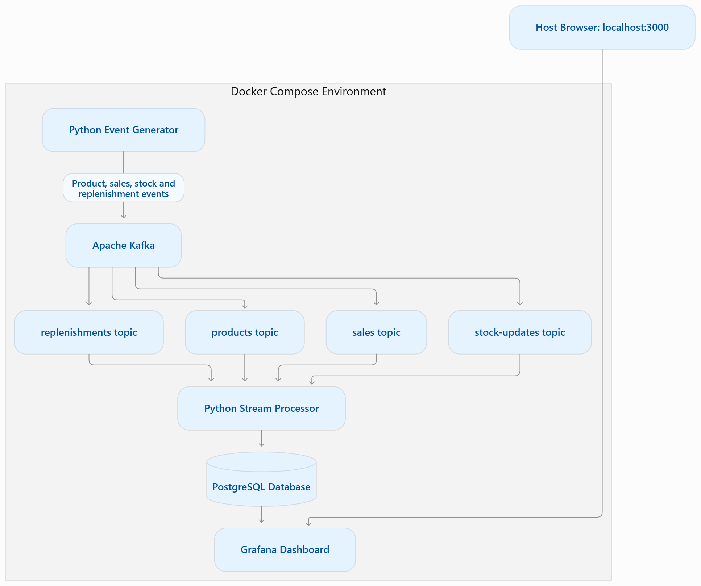

# Inventory Platform — Phase I

## Project Overview

This repository contains the Phase I architecture and design documentation for an inventory event-processing platform.

The project documents a streaming pipeline that generates events, processes them through Apache Kafka, stores processed data in PostgreSQL, and presents data through Grafana.

## Architecture

### Data Flow

1. **Python Event Generator** — generates sample events.
2. **Apache Kafka** — transports events through Kafka topics.
3. **Python Stream Processor** — consumes and processes events.
4. **PostgreSQL** — stores processed data.
5. **Grafana** — visualizes data from the database.

### Architecture Diagram

The editable Mermaid source is available at [`architecture/architecture-diagram.mmd`](architecture/architecture-diagram.mmd).

## Technology Stack

| Technology | Purpose |
|---|---|
| Python | Event generation and processing |
| Apache Kafka | Event streaming |
| PostgreSQL | Data storage |
| Grafana | Data visualization |
| Docker Compose | Local service orchestration |

## Documentation

- [Technology Decision Record](docs/technology-decision-record.md)
- [Reliability and Reprocessing](docs/reliability-and-reprocessing.md)
- [Architecture Diagram Source](architecture/architecture-diagram.mmd)

## Scope and Limitations

This repository documents the Phase I design and architecture. Features described as proposed or planned should not be assumed to be implemented.

Refer to the individual documentation files for design decisions, reliability considerations, and implementation limitations.
